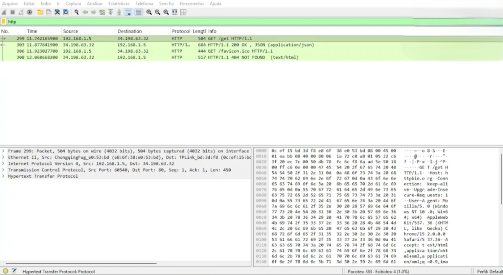
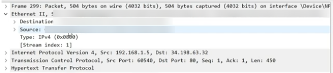
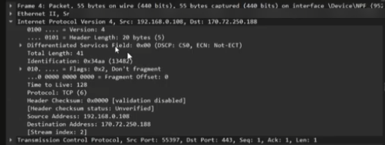
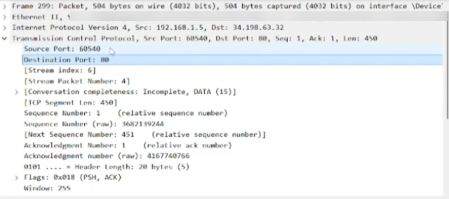
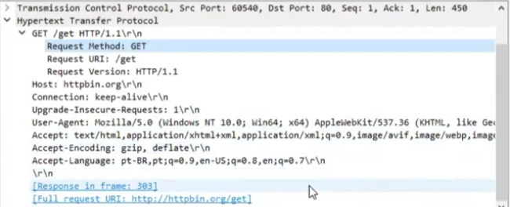
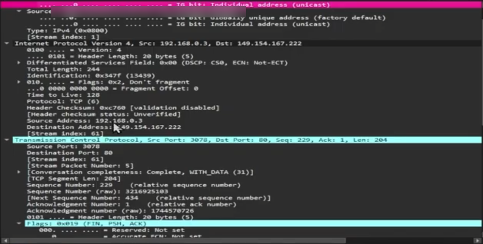

# Análise de Tráfego HTTP com Wireshark: Camadas do Modelo TCP/IP

Projeto em grupo (Equipe 07) do programa Mulher Digital / Cisco Networking Academy, Check Point 02.

## Objetivos

- Capturar uma requisição HTTP com o Wireshark
- Identificar as camadas do modelo TCP/IP em um pacote capturado
- Explicar o que cada camada adiciona ao pacote

## Como foi feito

A atividade foi concluída em 6 partes, seguindo o caminho do pacote: primeiro a captura do tráfego, depois uma camada por vez (Rede, Internet, Transporte e Aplicação) e, por fim, a integração de todas. A ideia foi mostrar que o mesmo pacote carrega as informações de todas as camadas ao mesmo tempo.

## Parte 1: Captura do tráfego

Com o Wireshark aberto, a captura foi feita enquanto o navegador fazia uma requisição para o httpbin.org. Depois, o filtro `http` foi aplicado para isolar só o tráfego HTTP. Foram 383 pacotes capturados e 4 exibidos com o filtro: um GET em `/get` com resposta 200 OK, e um GET em `/favicon.ico` com resposta 404.

*Imagem 1: Captura no Wireshark com o filtro `http` aplicado.*

## Parte 2: Camada de Rede (Ethernet II)

Por isso o pacote não vai direto para o destino final. Ele sai do computador para o roteador (gateway), que encaminha para o próximo roteador, e assim de salto em salto até chegar ao destino.

*Imagem 2: Cabeçalho Ethernet II com MAC de origem e de destino (endereços ocultados).*

## Parte 3: Camada Internet (IPv4)

Aqui entram os endereços IP de origem e destino, que permitem o roteamento do pacote entre redes. Na captura do projeto, a origem é o IP privado do computador (192.168.1.5) e o destino é o servidor do httpbin.org (34.198.63.32).

*Imagem 3: Cabeçalho IPv4 com origem, destino e protocolo TCP, em outra captura feita pelo grupo.*

## Parte 4: Camada de Transporte (TCP)

O TCP adiciona as portas de origem e destino, que identificam qual aplicação vai receber os dados. Na requisição analisada, a porta de origem é 60540 (aleatória, escolhida pelo cliente) e a de destino é 80, a porta padrão do HTTP. Também aparecem número de sequência, número de confirmação e as flags PSH e ACK.

*Imagem 4: Cabeçalho TCP com porta de origem 60540 e porta de destino 80.*

## Parte 5: Camada de Aplicação (HTTP)

É a camada que gera os dados da aplicação. Na requisição, o método é GET, o caminho é `/get`, a versão é HTTP/1.1 e o host é httpbin.org. O cabeçalho também mostra o User-Agent do navegador e o idioma aceito. O Wireshark ainda indica em qual pacote veio a resposta (pacote 303).

*Imagem 5: Requisição HTTP GET detalhada, com método, URI, versão e cabeçalhos.*

## Parte 6: Integração das camadas

Juntando tudo, o pacote sai da aplicação com os dados HTTP, recebe as portas no Transporte, os IPs na Internet e os MACs na Rede. Ao selecionar um pacote no Wireshark, todas essas camadas aparecem empilhadas no painel de detalhes, o que ajuda a entender o caminho completo da informação.

*Imagem 6: Visão das camadas Ethernet, IPv4 e TCP expandidas no mesmo pacote, em outra captura feita pelo grupo.*

## Minha parte

Fiquei responsável pela camada de Rede (Ethernet II). Na apresentação, mostrei no Wireshark os campos Destination, Source e Type do cabeçalho Ethernet e expliquei cada um. Também expliquei que o pacote não vai direto para o destino final: ele sai do computador para o roteador de casa, que o encaminha de roteador em roteador até chegar ao destino.

## Ferramentas

Wireshark

## Vídeo da apresentação

[Assista à apresentação no YouTube](https://www.youtube.com/watch?v=g9FiKO2rhLM)
